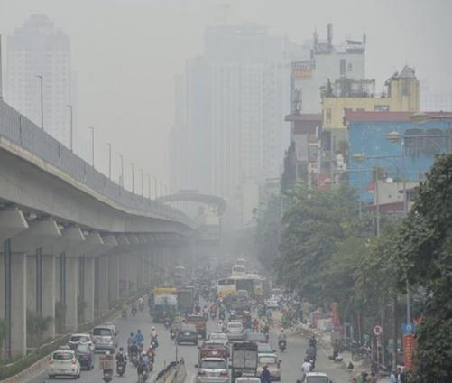
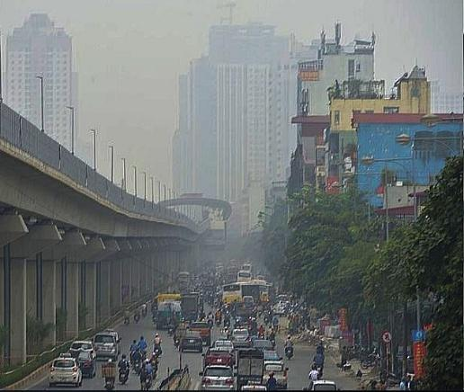
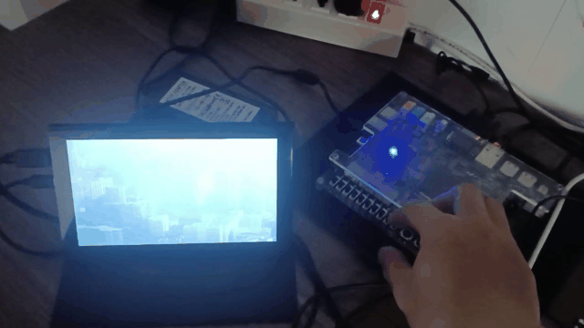
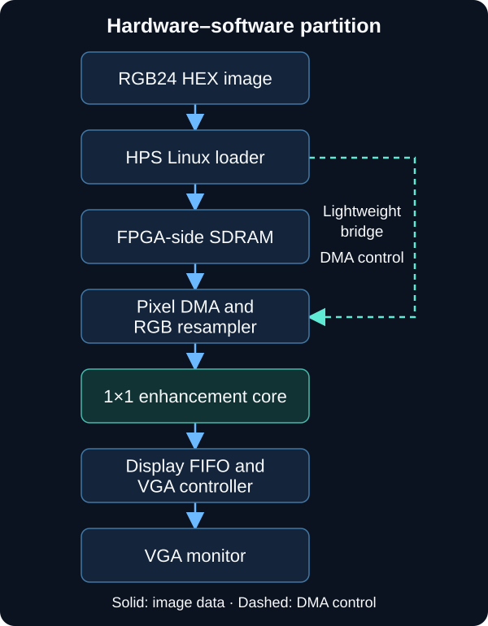
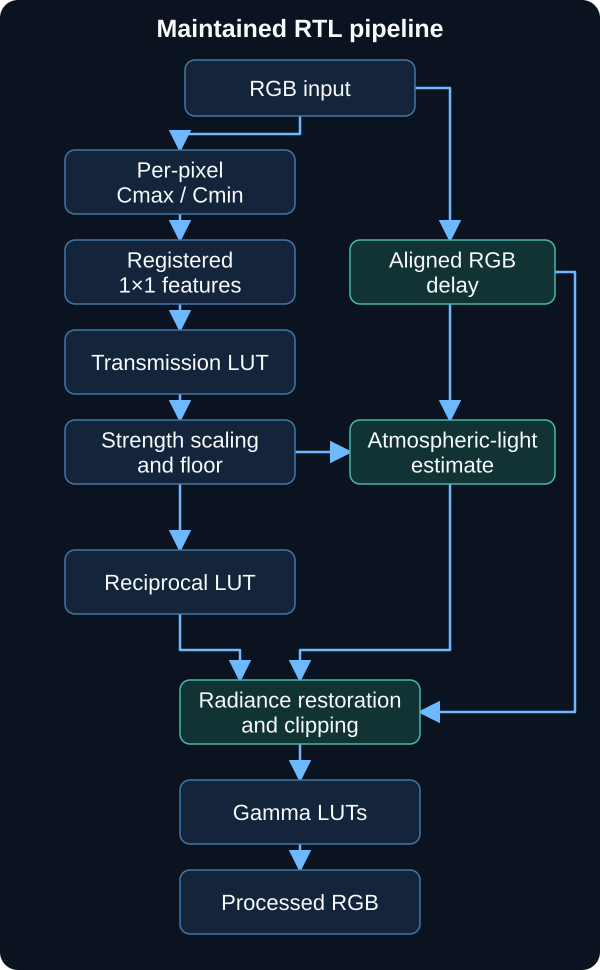

# Design and Implementation of a Vision Enhancement System on FPGA DE1-SoC

**Hardware–software co-design for image dehazing · Verilog RTL · ARM Linux · Cyclone V SoC**

[](https://github.com/DyDuy/fpga-vision-enhancement/actions/workflows/source-checks.yml)

[Visual results](#visual-results) · [Architecture](#architecture) · [Reported results](#reported-results) · [Quick start](#quick-start) · [Documentation](#documentation) · [Next steps](#next-steps)

## Overview

This project explores FPGA acceleration of visibility enhancement for hazy images on the **Terasic DE1-SoC**. It combines a lookup-table-based pixel-processing core with an HPS Linux application that loads a still image into SDRAM for processing and VGA display. The maintained hardware is a **1×1, per-pixel implementation**, rather than a spatial 15×15 dark-channel filter. [Implementation: active hardware scope][hardware-scope]; [HPS image-loading and display path, lines 19–72][hps-viewer].

The associated manuscript, *A Real-Time FPGA-Based Vision Enhancement System*, describes the algorithm, RTL co-simulation and a still-image board demonstration. The author's thesis, defense slides and research journal provide additional historical image results, a board demonstration recording and implementation records. This README distinguishes **reported experiments** from verification of the current source tree. Continuous camera-to-display operation remains an integration step. [Manuscript: abstract][paper-abstract]; [supplemental source inventory and evidence boundaries](paper/thesis/supplemental-evidence.md#source-inventory); [current verification record, lines 35–39][build-status].

| At a glance | Current implementation |
|---|---|
| Platform and design entry | DE1-SoC; `hardware/de1_soc/DE1_SoC_Computer.qpf` |
| Processing core | RGB channel extrema → transmission lookup → clamp → restoration → gamma |
| Application path | HPS loads a 640×480 RGB24 HEX image; Pixel DMA feeds the FPGA/VGA path |
| Development flow | Python tooling, Quartus Prime Lite 18.1 / Platform Designer, ARM Linux cross-build |

Sources: [hardware entry point, lines 1–19][hardware-project]; [RTL stage connections, lines 71–127][rtl-pipeline]; [HPS source, lines 25–72][hps-viewer]; [ARM build configuration, lines 26–50][hps-build].

## Visual results

| Hazy input | Enhanced result |
|:---:|:---:|
|  |  |

*Source: thesis **Figure 3.3**, PDF page 44 / printed page 29. Original embedded JPEGs are reproduced without pixel changes; this pair is a thesis result illustration, not an identified FPGA capture. [Figure provenance and asset checksums](paper/thesis/supplemental-evidence.md#image-results-and-setup).*

### DE1-SoC demonstration excerpt



*Source: defense **slide 31**, embedded video, **2:33–2:45**. This historical excerpt shows the board, filmed display and switch interaction; video exposure and display colors do not establish quantitative image fidelity or current-commit validation. GIF sampling is not hardware throughput. [Recording context, export method and limitations](paper/thesis/supplemental-evidence.md#image-results-and-setup).*

The manuscript also provides [Scene 3 input and ModelSim output, Figure 3, lines 84–88][paper-figures]. Its simulation images and the thesis illustrations are separate evidence sets.

## Architecture

### Hardware–software partition

The HPS utility writes the image through the heavyweight bridge and controls Pixel DMA through the lightweight bridge. Platform Designer connects the VGA subsystem's outgoing pixel stream to the custom core and returns the processed stream to the display subsystem. [HPS memory access and DMA setup, lines 25–72][hps-viewer]; [Qsys stream connections, lines 1230–1255][qsys-stream].



The display subsystem includes DMA, an RGB resampler, a dual-clock FIFO and a VGA controller. A live video-input subsystem exists in the platform sources, but its presence does not establish an end-to-end camera demonstration. [VGA subsystem modules/connections, lines 137–225][vga-system]; [current validation limits][build-status].

### Maintained RTL pipeline



The diagram follows the **current RTL**, including the registered `dark_channel_1x1` stage and parallel atmospheric-light estimator. [Stage wiring, lines 71–127][rtl-pipeline]; [feature/transmission stages, lines 247–362][rtl-features]; [restoration/atmospheric estimation, lines 368–486][rtl-restoration].

- **Windowless features:** per-pixel channel extrema address a 65,536-entry × 10-bit transmission ROM. The manuscript motivates this mapping through the 1×1 identity $C_{\min}=V(1-S)$, avoiding a spatial neighborhood in the estimator. [RTL, lines 247–303][rtl-features]; [manuscript §2, lines 31–39][paper-algorithm].
- **Controlled restoration:** the current instance uses `STRENGTH=256` and `T_FLOOR=102`; reciprocal lookup, signed multiplication and clipping implement restoration. Gamma correction uses separate channel lookups. [RTL parameters/clamp][rtl-features]; [restoration, lines 368–458][rtl-restoration]; [gamma, lines 145–189][rtl-gamma].
- **Stream control and comparison:** `src_ready` gates processing; SOP/EOP and the original pixel stream are delayed alongside the core. `SW[0]=0` selects the delayed original and `SW[0]=1` selects enhancement. The RTL declares `TOTAL_DELAY=11`; stall and frame-boundary correctness still require dedicated regression evidence. [RTL control/mux, lines 3–59 and 130–139][rtl-control]; [board switch connection, lines 414–418][board-switch]; [verification plan][verification].

For the scattering model, transmission formulation and fixed-point rationale, read [manuscript §2–3][paper-algorithm]. Algorithm intent and current-source validation are separate evidence layers.

## Reported results

**These are historical reported results, not measurements from this checkout.** The manuscript and thesis/defense values are kept separate because their exact source revisions and build correspondence have not been established. Values describe the complete system unless marked as core-only. [Manuscript §4.2, Table 2, lines 103–121][paper-resources]; [thesis Table 3.1, PDF pages 41–42 / printed pages 26–27; defense slide 20](paper/thesis/supplemental-evidence.md#resource-and-timing-records).

| Metric | Manuscript | Thesis / defense |
|---|---:|---:|
| Device | Cyclone V SoC `5CSEMA5F31C6` | Cyclone V SoC `5CSEMA5F31C6` |
| Logic utilization | 6,279 / 32,070 ALMs — 20% | 6,021 / 32,070 ALMs — 19% |
| Registers | 4,875 | 4,851 |
| On-chip memory | 1,113,243 / 4,065,280 bits — 27% | 1,113,192 / 4,065,280 bits — 27% |
| DSP blocks | 8 / 87 system-wide; 3 attributed to the core | 8 / 87 system-wide |
| Restricted Fmax | 121.64 MHz, slow 85°C corner | Not established by the reviewed extracts |
| Reported still-image operating clock | 50 MHz | 50 MHz |

The thesis appendix identifies Quartus Prime 18.1.0 Build 625. Its timing screenshots include an HPS SDRAM analysis and a **“Design is not fully constrained”** warning; the reported slack table does not establish full pixel-datapath timing closure or Fmax. [Thesis Figures B.12–B.14, PDF pages 62–64 / printed pages 37–39; timing context](paper/thesis/supplemental-evidence.md#resource-and-timing-records).

The manuscript additionally reports a one-pixel-per-clock pipeline with 11 cycles of latency and bit-exact agreement with its MATLAB/ModelSim fixed-point reference. These are reported core properties; they do not establish current-checkout camera frame rate, end-to-end display latency or a reproduced timing sign-off. [Manuscript §3 and §4.1, lines 66–84][paper-verification].

### Verification status

| Evidence layer | Scope |
|---|---|
| Source and tooling checks | Active files, Qsys XML, IP paths, ROM dimensions, Python tooling tests and Linux HPS C syntax; CI does not simulate or synthesize RTL. |
| Current FPGA build record | Manual Quartus Prime Lite 18.1.0 Build 625 compilation recorded on 2026-10-04; unresolved timing-constraint warnings and clean automatic-build reproduction remain. |
| Authored experiment records | Manuscript experiments, thesis image pairs, a defense demo excerpt and journal methodology are available; matching current-version regressions and board artifacts remain to be consolidated. |

Sources: [CI workflow, lines 9–15][ci-scope]; [current build/limitations record, lines 35–39][build-status]; [verification plan][verification]; [manuscript §4.1][paper-verification]; [supplemental evidence and limitations](paper/thesis/supplemental-evidence.md#evidence-boundaries). Historical artifacts and older implementation reviews should be read in their recorded context; the maintained source scope is documented in [hardware/README.md][hardware-scope].

## Quick start

Run commands from the repository root. Use the source checks first, then choose the FPGA build or HPS application path.

### 1. Get the source and run portable checks

```bash
git clone https://github.com/DyDuy/fpga-vision-enhancement.git
cd fpga-vision-enhancement
python -m pip install -r software/python/requirements.txt
python software/python/check_project.py
```

Python dependencies are declared in [`requirements.txt`](software/python/requirements.txt); CI uses Python 3.12. On Linux, also check HPS source syntax:

```bash
python software/python/check_project.py --hps-syntax
```

These checks require no FPGA board and provide source/tooling validation. [Check coverage][verification]; [CI environment and commands, lines 9–15][ci-scope].

### 2. Prepare a still image — optional

```bash
python software/python/image_hex.py encode input.jpg build/images/input_image.hex --width 640 --height 480
```

The encoder converts to RGB, resizes the input and writes one `RRGGBB` token per pixel. The HPS viewer expects a 640×480 image and uses a 1,024-word row stride in SDRAM. [Encoder/CLI, lines 6–14 and 35–47][image-tool]; [viewer dimensions/stride, lines 41–57][hps-viewer].

### 3. Generate and compile the FPGA system

Use **Quartus Prime Lite 18.1**, with the device and IP support required by the project. In PowerShell, adjust the installation path:

```powershell
$env:QUARTUS_ROOTDIR = 'C:\intelFPGA_lite\18.1\quartus'
python software/python/build_fpga.py compile
```

`compile` stages fresh inputs, generates the VGA, Video-In and parent Qsys systems, then invokes compilation. A separate `generate` invocation is unnecessary. Each run has input hashes, logs and status under `build/quartus/vision_1x1/runs/`; `latest.json` identifies the last started run, which may be incomplete. [Build workflow, lines 7–22][build-workflow].

For GUI work, open `hardware/de1_soc/DE1_SoC_Computer.qpf`. Edit canonical RTL/Qsys/pin sources rather than generated run copies. See the [FPGA build guide](docs/development/automatic-build.md) for IP search paths, regeneration and timing constraints to review.

### 4. Cross-build the HPS application

In Linux or WSL, use an **ARM Linux hard-float** compiler compatible with the board's Linux image. The script defaults to `arm-linux-gnueabihf-gcc`:

```bash
bash software/hps/build.sh all
# Output: build/hps/linux/bin/vga_simple_display
```

The build targets Cortex-A9/VFPv3-D16 with the hard-float ABI. Confirm target library compatibility before deployment; use `CC=/path/to/compiler` when the board image requires a different toolchain/sysroot. [Compiler checks and flags, lines 26–50][hps-build]; [HPS toolchain/deployment guide, §D](docs/development/vscode-hps-build.md#d--điều-kiện-vận-hành-và-giới-hạn).

### 5. Run on the DE1-SoC

Configure the board with the matching FPGA build, boot compatible Linux, enable the required HPS–FPGA bridges and connect VGA. Transfer the executable and prepared HEX file to the board, then run **on the target only**:

```bash
sudo ./vga_simple_display input_image.hex
```

The utility accesses `/dev/mem`, depends on the matching [address map](software/hps/include/hps_fpga_addresses.h) and remains running after display setup. Review its legacy input/error handling before use beyond a controlled demonstration. FPGA programming, Linux-image preparation and automatic deployment are not performed by the build script. [HPS operating requirements, lines 3–16][hps-requirements]; [application behavior, lines 19–83][hps-viewer]; [deployment limits](docs/development/vscode-hps-build.md#d--điều-kiện-vận-hành-và-giới-hạn).

## Documentation

```text
hardware/
  de1_soc/       Maintained board/core RTL, ROMs and Quartus project
  pin/           Pin assignments and timing constraints
  qsys/          Editable Platform Designer systems
software/
  hps/           ARM Linux display utility and address definitions
  python/        Source checks, FPGA builds and image conversion
  matlab/        Algorithm/reference work
paper/article/   Manuscript text and tracked figures
paper/thesis/    Thesis archive index and supplemental evidence notes
docs/            Architecture, workflow, verification and project history
build/           Generated local outputs; excluded from Git
```

| Read next | Purpose |
|---|---|
| [Active hardware](hardware/README.md) / [Quartus project](hardware/de1_soc/README.md) | Canonical source ownership and project entry points |
| [FPGA workflow](docs/development/automatic-build.md) / [build layout](docs/development/build-layout.md) | Fresh builds, logs and artifact handling |
| [HPS utility](software/hps/README.md) / [WSL and VS Code guide](docs/development/vscode-hps-build.md) | Cross-compilation, ABI and board prerequisites |
| [Python tools](software/python/README.md) / [verification](docs/development/verification.md) | Executable checks and remaining validation gates |
| [Full manuscript](paper/article/53_20260916_A_real_time_FPGA_based_vision_enhancement_system_Final_Submission.md) | Algorithm, figures, experiments and bibliography |
| [Thesis, defense and journal evidence](paper/thesis/supplemental-evidence.md) | Source checksums, exact pages/slides, reviewed figures and historical build context |
| [Documentation index](docs/README.md) / [contributing](CONTRIBUTING.md) | Design notes, history and contribution workflow |

Some research and migration notes describe retired source layouts. For current build instructions, use the active hardware and FPGA workflow guides above.

## Next steps

Historical image results and a board demonstration excerpt are now documented above. The next additions should connect those experiment records to a reproducible build of the maintained source:

- **Current-build board demo:** an original/enhanced capture tied to a source commit, bitstream checksum, clock and switch settings.
- **Reproducible verification:** fixed-point reference inputs/outputs, a maintained RTL testbench and regressions for reset, stalls and frame boundaries.
- **Build evidence:** a matching Quartus input manifest, fit/timing reports and review of clock/false-path constraints.
- **Image-quality reproduction:** evaluation images, metric scripts and configurations corresponding to manuscript Table 1.
- **Live camera integration:** validate capture, clock crossings, backpressure and display as one continuous path before reporting video throughput.

These additions address open evidence and integration items in the [verification plan][verification], [current build record][build-status] and [manuscript experiments][paper-verification].

## Authors and acknowledgments

**Cao Khanh Duy (Duy K. Cao)** — project author. The manuscript is co-authored with **Kien T. Truong**, Faculty of Physics and Engineering Physics, University of Science (HCMUS), Vietnam National University–Ho Chi Minh City. [Manuscript title and author block, lines 1–7][paper-authors].

Algorithm references are listed in the [manuscript bibliography](paper/article/53_20260916_A_real_time_FPGA_based_vision_enhancement_system_Final_Submission.md#references). Platform and prior-work resources retained from the project include [Terasic DE1-SoC documentation](https://www.terasic.com.tw/cgi-bin/page/archive.pl?Language=English&No=836), [Intel Avalon Interface Specifications](https://www.intel.com/content/www/us/en/docs/programmable/683091/current/avalon-interface-specifications.html), [Cornell HPS/FPGA peripheral examples](https://people.ece.cornell.edu/land/courses/ece5760/DE1_SOC/HPS_peripherials/univ_pgm_computer.index.html) and the [Cornell FPGA dehazing report](https://people.ece.cornell.edu/land/courses/eceprojectsland/STUDENTPROJ/2015to2016/sm893_mkp53/Final%20Report%20ECE%204999.pdf).

Retain original notices and terms for third-party IP, examples and reference material. This README assigns no new license to source, manuscript or figures; see the [publication/provenance notes](paper/article/source-provenance.md#quyền-phân-phối) before redistributing publication assets.

<!-- Evidence links are pinned to the source snapshot reviewed for this README. -->
[hardware-scope]: https://github.com/DyDuy/fpga-vision-enhancement/blob/5e287f1821ffd83656033a32633448babdc4a698/hardware/README.md#L1-L13
[hardware-project]: https://github.com/DyDuy/fpga-vision-enhancement/blob/5e287f1821ffd83656033a32633448babdc4a698/hardware/de1_soc/README.md#L1-L19
[rtl-pipeline]: https://github.com/DyDuy/fpga-vision-enhancement/blob/5e287f1821ffd83656033a32633448babdc4a698/hardware/de1_soc/dehazing_system_top.v#L71-L127
[rtl-features]: https://github.com/DyDuy/fpga-vision-enhancement/blob/5e287f1821ffd83656033a32633448babdc4a698/hardware/de1_soc/dehazing_system_top.v#L247-L362
[rtl-restoration]: https://github.com/DyDuy/fpga-vision-enhancement/blob/5e287f1821ffd83656033a32633448babdc4a698/hardware/de1_soc/dehazing_system_top.v#L368-L486
[rtl-gamma]: https://github.com/DyDuy/fpga-vision-enhancement/blob/5e287f1821ffd83656033a32633448babdc4a698/hardware/de1_soc/dehazing_system_top.v#L145-L189
[rtl-control]: https://github.com/DyDuy/fpga-vision-enhancement/blob/5e287f1821ffd83656033a32633448babdc4a698/hardware/de1_soc/dehazing_system_top.v#L3-L139
[board-switch]: https://github.com/DyDuy/fpga-vision-enhancement/blob/5e287f1821ffd83656033a32633448babdc4a698/hardware/de1_soc/DE1_SoC_Computer.v#L414-L418
[qsys-stream]: https://github.com/DyDuy/fpga-vision-enhancement/blob/5e287f1821ffd83656033a32633448babdc4a698/hardware/qsys/Computer_System.qsys#L1230-L1255
[vga-system]: https://github.com/DyDuy/fpga-vision-enhancement/blob/5e287f1821ffd83656033a32633448babdc4a698/hardware/qsys/VGA_Subsystem.qsys#L137-L225
[hps-viewer]: https://github.com/DyDuy/fpga-vision-enhancement/blob/5e287f1821ffd83656033a32633448babdc4a698/software/hps/src/vga_simple_display.c#L19-L83
[hps-build]: https://github.com/DyDuy/fpga-vision-enhancement/blob/5e287f1821ffd83656033a32633448babdc4a698/software/hps/build.sh#L26-L50
[hps-requirements]: https://github.com/DyDuy/fpga-vision-enhancement/blob/5e287f1821ffd83656033a32633448babdc4a698/software/hps/README.md#L3-L16
[image-tool]: https://github.com/DyDuy/fpga-vision-enhancement/blob/5e287f1821ffd83656033a32633448babdc4a698/software/python/image_hex.py#L6-L47
[build-workflow]: https://github.com/DyDuy/fpga-vision-enhancement/blob/5e287f1821ffd83656033a32633448babdc4a698/docs/development/automatic-build.md#L7-L22
[build-status]: https://github.com/DyDuy/fpga-vision-enhancement/blob/5e287f1821ffd83656033a32633448babdc4a698/docs/development/automatic-build.md#L35-L39
[verification]: https://github.com/DyDuy/fpga-vision-enhancement/blob/5e287f1821ffd83656033a32633448babdc4a698/docs/development/verification.md#L3-L31
[ci-scope]: https://github.com/DyDuy/fpga-vision-enhancement/blob/5e287f1821ffd83656033a32633448babdc4a698/.github/workflows/source-checks.yml#L9-L15
[paper-authors]: https://github.com/DyDuy/fpga-vision-enhancement/blob/5e287f1821ffd83656033a32633448babdc4a698/paper/article/53_20260916_A_real_time_FPGA_based_vision_enhancement_system_Final_Submission.md#L1-L7
[paper-abstract]: https://github.com/DyDuy/fpga-vision-enhancement/blob/5e287f1821ffd83656033a32633448babdc4a698/paper/article/53_20260916_A_real_time_FPGA_based_vision_enhancement_system_Final_Submission.md#L10-L12
[paper-algorithm]: https://github.com/DyDuy/fpga-vision-enhancement/blob/5e287f1821ffd83656033a32633448babdc4a698/paper/article/53_20260916_A_real_time_FPGA_based_vision_enhancement_system_Final_Submission.md#L25-L70
[paper-figures]: https://github.com/DyDuy/fpga-vision-enhancement/blob/5e287f1821ffd83656033a32633448babdc4a698/paper/article/53_20260916_A_real_time_FPGA_based_vision_enhancement_system_Final_Submission.md#L84-L88
[paper-verification]: https://github.com/DyDuy/fpga-vision-enhancement/blob/5e287f1821ffd83656033a32633448babdc4a698/paper/article/53_20260916_A_real_time_FPGA_based_vision_enhancement_system_Final_Submission.md#L66-L84
[paper-resources]: https://github.com/DyDuy/fpga-vision-enhancement/blob/5e287f1821ffd83656033a32633448babdc4a698/paper/article/53_20260916_A_real_time_FPGA_based_vision_enhancement_system_Final_Submission.md#L103-L121
