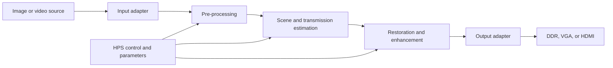

# Target architecture

This is the target architecture, not a claim about the current implementation. The algorithm core exposes a small streaming interface; board, bus, and DDR details remain in adapters around that boundary.

## Responsibility boundaries

- `software/matlab/`: algorithm prototype and numerical exploration; it is not a validated fixed-point golden model.
- `hardware/archive/project-inputs/`: preserved candidate RTL, board wrapper, QPF/QSF/SDC, IP Tcl, and LUT inputs; this is historical intake, not active source.
- `hardware/verification/intake-20261004/`: imported RTL, testbench, fixtures, and simulator-state evidence.
- `hardware/qsys/` and `hardware/pin/`: current Platform Designer input files and board constraints; their dependency closure still requires review.

The repository is intended to contain a DE1-SoC implementation under `hardware/de1_soc/`, but the current checkout lacks the expected active manifest and source set there. Treat `hardware/archive/project-inputs/` RTL and generated Quartus output as historical or generated evidence until a reviewed active manifest explicitly selects a restored source set.
