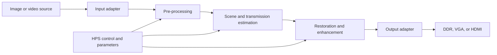

# Target architecture

This is the target architecture, not a claim about the current implementation. The algorithm core exposes a small streaming interface; board, bus, and DDR details remain in adapters around that boundary.

## Responsibility boundaries

- `model/`: reference algorithms and numerical exploration.
- `hardware/archive/sources/rtl/chisel/`: historical proof-of-concept Chisel location; the old payload is no longer present in the active checkout.
- Create a SystemVerilog location only when a real implementation exists; empty scaffolding has been removed.
- `hardware/archive/sources/verification/`: verification around the core interface.
- `hardware/archive/sources/boards/de1_soc/`: clocks, pins, Platform Designer, and board-level top level.

The repository is intended to contain a DE1-SoC implementation under `hardware/de1_soc/`, but the current checkout lacks the expected active manifest and source set there. Treat `hardware/archive/project-inputs/` RTL and generated Quartus output as historical or generated evidence until a reviewed active manifest explicitly selects a restored source set.
