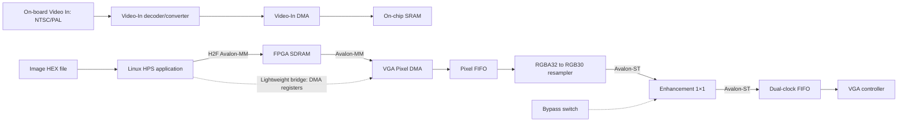

# System anatomy

This document explains the current FPGA vision-enhancement system as an engineering system: ownership, data paths, clock domains, numerical boundaries, memory, software, and evidence limits. It distinguishes observed implementation facts from target architecture and open verification work.

## 1. Executive summary

The documented design snapshot is named `vision_1x1` and targets a Terasic DE1-SoC with Cyclone V device `5CSEMA5F31C6`. The current HPS application is the Linux program `vga_simple_display`, built with an ARM Linux hard-float toolchain for the Cortex-A9 HPS. The current checkout does not contain the expected active FPGA manifest and source files under `hardware/de1_soc/`; most files there are ignored Quartus outputs. The implementation details below therefore describe the preserved design snapshot and local generated evidence, not a verified active source checkout.

The preserved enhancement RTL accepts a 30-bit RGB stream, extracts three 8-bit channels, computes per-pixel extrema, uses a transmission LUT, applies a refinement scale/clamp, restores RGB, and applies gamma correction. This snapshot is a 1×1 per-pixel path; it must not be described as a 15×15 spatial-window implementation merely because older documents or the thesis mention that window size.

A manual Quartus report exists, but the current repository state does not establish a fresh reproducible build, complete timing sign-off, bit-accurate model agreement, or board operation. Historical reports and archived RTL are evidence with separate provenance.

## 2. Ownership and system boundary

```text
                         Research and verification
  reference model -> fixed-point model -> vectors -> RTL scoreboard
          |                                  ^
          |                                  |
          +------------------------------ core interface
                                             |
Image/video -> input adapter -> stream -> enhancement core -> stream -> output adapter
                                         ^                 |
                                         |                 v
                                   HPS control        DDR/VGA/HDMI
```

The processing core owns pixel transformation and local pipeline state. Board adapters own camera/video input, display output, HPS bridges, DDR, DMA, clock crossings, and board constraints. The separation follows [ADR 0001](../decisions/0001-repository-layout.md).

The intended source ownership is:

- `hardware/de1_soc/`: expected active Quartus project, top level, enhancement RTL, IP descriptor, ROMs, and build manifest; the expected source set is currently incomplete;
- `hardware/qsys/`: Platform Designer input systems;
- `hardware/pin/`: pin assignments and timing constraints;
- `hardware/archive/project-inputs/`: preserved legacy companion inputs, including a candidate RTL/IP/ROM set;
- `software/hps/`: HPS Linux application, address header, and cross-build scripts;
- `software/python/`: staging, checking, conversion, archive, and failure-logging tools.

`hardware/archive/` and `hardware/verification/intake-20261004/` are historical or intake snapshots. Generated Qsys trees, Quartus databases, and reports are not canonical edit locations. Do not treat the archive as active source until it has been explicitly restored, reviewed, and selected by the build manifest.

## 3. Current image paths

The current Qsys design contains two conceptually separate image paths:



### Video-In path

The Qsys Video-In subsystem selects the on-board NTSC/PAL video input. Its DMA writes on-chip SRAM at `0x08000000`. The presence of this IP does not prove that a camera, decoder, enhancement core, and display have been validated end to end.

### HPS-to-VGA path

The HPS application maps the heavyweight and lightweight bridges, writes a frame buffer to SDRAM, and configures the VGA DMA/back-buffer registers. The VGA DMA reads SDRAM, the FIFO/resampler produces the RGB30 stream, and the enhancement core feeds the output-side FIFO and VGA controller.

There is no direct current Qsys connection from Video-In DMA to the enhancement/display path described above. Continuous camera enhancement therefore requires an explicit buffer-transfer policy or a revised Qsys connection. This is an architectural observation, not a claim that the board cannot display video.

## 4. Pixel and numerical boundaries

The implementation snapshot and centralized reference files describe these boundaries:

| Boundary | Current reference |
|---|---|
| Image dimensions | 640 × 480 |
| Input/output Avalon-ST | 30 bits |
| Internal RGB | 24 bits, 8 bits per channel |
| HPS image packing | `0xRRGGBB` in the current application |
| Transmission LUT | 65,536 entries × 10 bits, addressed by `{Cmax,Cmin}` |
| Gamma LUT | Three channel tables, 256 entries × 8 bits |
| Inverse-transmission LUT | 1,024 entries × 14 bits in the archived design metadata |
| Refinement constants | `STRENGTH=256`, `T_FLOOR=102` in the current RTL snapshot |

The exact scale and normalization conventions are not yet an approved Q-format contract. A reference model must specify signedness, fractional bits, multiplication width, shift/rounding, saturation, LUT generation, and valid parameter ranges before a bit-accurate claim is made.

The centralized files under `configs/` are reference/design-contract files. They are not currently consumed by Verilog, Qsys, Quartus, HPS software, or `software/python/build_fpga.py`. A validator or generator must be added before they become authoritative inputs.

## 5. Pipeline, clock, and handshake behavior

The archived/current RTL notes an 11-cycle nominal pipeline delay, described as `5 + 4 + 2`. This is a declared pipeline latency, not a measured end-to-end latency under stalls. The implementation contains delayed valid and sideband signals and a bypass control; reset, bubble, backpressure, and frame-boundary behavior require dedicated simulation.

The surrounding system contains at least these clock references:

- 50 MHz reference clock in historical design metadata;
- 100 MHz Qsys/system clock in the current Platform Designer configuration;
- 25 MHz VGA output clock.

The intended core clock must be reconciled before the YAML or any timing claim is treated as authoritative. The dual-clock FIFO is the explicit boundary between the 100 MHz input-side domain and the 25 MHz VGA-side domain.

Required verification properties include:

- no pixel loss or duplication at valid/ready handshakes;
- stable output data and sideband while stalled;
- correct SOP/EOP or frame/line markers;
- no false valid during reset warm-up;
- correct ordering across consecutive frames;
- correct bypass switching policy;
- defined behavior when the downstream consumer applies backpressure.

## 6. Memory and HPS contract

The HPS header and Qsys configuration describe a 640×480 frame with a stride of 1024 address units/pixels in the current DMA layout. The software currently uses constants and expressions equivalent to `SCREEN_WIDTH=640`, `SCREEN_HEIGHT=480`, `DMA_STRIDE=1024`, and `(y << 10) + x`.

Do not change the stride to 640 solely because the visible width is 640. The current VGA DMA uses X/Y addressing and generated HDL combines line and pixel address fields with byte-offset bits. The header, Qsys configuration, generated DMA logic, and bitstream must be checked together.

The memory-map contract must cover:

- lightweight and heavyweight bridge bases;
- DMA register offsets and ownership;
- SDRAM/frame-buffer base and buffer range;
- width, height, pixel packing, and stride;
- back-buffer/swap behavior;
- cache and coherency requirements;
- the bitstream/configuration version expected by HPS software.

See [`configs/memory_map.yaml`](../../configs/memory_map.yaml), [`software/hps/include/hps_fpga_addresses.h`](../../software/hps/include/hps_fpga_addresses.h), and [`software/hps/src/vga_simple_display.c`](../../software/hps/src/vga_simple_display.c). The YAML/header map has not been validated against a newly generated system or a board run.

## 7. Software lifecycle

The HPS builder snapshots C/header inputs and compiles them in WSL/Linux using the ARM hard-float toolchain. Each run records sources, logs, binary, command, compiler/toolchain information, Git state, and hashes under `build/hps/linux/runs/<run-id>/`. Only a successful run updates the convenience binary under `build/hps/linux/bin/`.

The application uses `/dev/mem`, so a host compile is not a runtime test. Before board deployment, verify the Linux ABI/sysroot, FPGA bitstream, bridge addresses, DMA layout, and permissions. The current build target is `vga_simple_display`; historical `memory_benchmark` output is not reproducible from the current source tree.

The image parser and buffer lifecycle require separate tests for malformed tokens, short/long files, out-of-range RGB values, partial mapping failures, and cleanup. Do not enable DMA or publish a frame until the input satisfies the declared pixel contract.

## 8. Evidence and confidence levels

| Claim | Current evidence | Confidence boundary |
|---|---|---|
| Repository ownership and build tooling | Active source tree, build manifest, checker, staging, HPS cross-build | Does not prove clean-checkout Quartus reproduction. |
| Current RTL/LUT structure | Active RTL and LUT files plus local generated Qsys/Quartus material | Does not prove algorithmic correctness or bit-accurate model agreement. |
| Manual Quartus compilation | Local report states successful Quartus 18.1 flow | Reports have unresolved constraint warnings and are not tied here to a fresh source hash. |
| HPS software compilation | Cross-build path and run recorder | Does not prove board MMIO, DMA, VGA, ABI, or bridge compatibility. |
| Historical resource/timing numbers | Archived manifests and reports | Do not mix with current source or paper numbers without provenance. |
| Real-time image quality | No current model/RTL/board benchmark | Requires dataset, baseline, metrics, run configuration, and evidence. |

## 9. Recommended verification order

1. Freeze the pixel, memory, stream, clock, reset, and numerical contracts.
2. Add a bit-accurate reference model and generate vectors from the same LUT/configuration source.
3. Build an RTL scoreboard covering valid/ready, stalls, reset, frame boundaries, bypass, and latency.
4. Validate the HPS parser and buffer lifecycle on the host; then cross-build.
5. Reconcile Qsys addresses, HPS headers, stride, and generated DMA logic.
6. Classify every pin, clock, CDC/RDC, unconstrained-path, and false-path warning.
7. Run a clean-checkout Quartus flow and retain tool version, source hash, reports, and bitstream provenance.
8. Validate the target board with a known bitstream and capture images/logs.
9. Only then report throughput, resource usage, timing, power, and image-quality results.

Until these gates are complete, describe the system as an active implementation snapshot with historical evidence—not as a fully validated real-time dehazing product.
