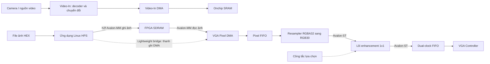

# Giải phẫu dự án FPGA Vision Enhancement

Ngày đánh giá: **2026-10-04**. Mốc Git đối chiếu do phiên kiểm tra xác định: **`main`, `5e287f1821ffd83656033a32633448babdc4a698`**. Đây là đánh giá mã nguồn, tổ chức dự án và bằng chứng build hiện có; không phải xác thực hoạt động trên board. Những giới hạn này cũng được ghi trong [hướng dẫn dự án](project-guide.md), dòng 74–81, và [kế hoạch kiểm chứng](verification.md), dòng 14–31.

**Kết luận:** cách chia `hardware/`, `software/`, `docs/`, `paper/`, `ref/` và `build/` hợp lý cho một prototype FPGA SoC. Nên giữ cấu trúc này và nâng chất lượng ở hợp đồng số học, luồng dữ liệu, kiểm chứng RTL, pin/timing và khả năng build lại. Đây là nhận định thiết kế dựa trên [sơ đồ repo](project-guide.md), dòng 7–34, [manifest build](../../hardware/de1_soc/build.json), dòng 7–30, và các thiếu hụt kiểm chứng được ghi trong [verification.md](verification.md), dòng 26–31; không phải điểm số trưởng thành hay chứng nhận sản phẩm.

## A. Kiến trúc, luồng dữ liệu và tổ chức thư mục

### A1. Dự án đang triển khai cái gì?

Thiết kế build hiện hành mang tên `vision_1x1`, target Cyclone V `5CSEMA5F31C6`, có một project Quartus `DE1_SoC_Computer`; manifest chỉ định sinh VGA, Video-In rồi Computer_System. Nguồn: [build.json](../../hardware/de1_soc/build.json), dòng 2–15. Ứng dụng HPS hiện build là `vga_simple_display`, dùng compiler ARM Linux hard-float và tùy chọn Cortex-A9; nguồn: [build.sh tại mốc đối chiếu](https://github.com/DyDuy/fpga-vision-enhancement/blob/5e287f1821ffd83656033a32633448babdc4a698/software/hps/build.sh#L13-L50), dòng 13–18 và 26–50. Vì vậy môi trường phần mềm hiện tại là **Linux trên HPS**, không phải firmware Cortex-M hay bare-metal.

Lõi active lấy ba kênh 8-bit từ RGB30, tính cực đại/cực tiểu từng pixel, tra transmission LUT, scale/clamp transmission, khôi phục RGB và gamma. `dark_channel_1x1` chỉ đăng ký `Cmax/Cmin`; `refinement_1x1` là phép nhân/shift/clamp. Nhận định này rút trực tiếp từ [dehazing_system_top.v](../../hardware/de1_soc/dehazing_system_top.v), dòng 27–30, 75–127, 247–288 và 334–362. Không được dùng mô tả cửa sổ không gian để giải thích hai khối này.

### A2. Hai đường ảnh đang tách nhau



Sơ đồ mô tả kết nối đang có trong mã. “Camera / nguồn video” là đầu vào khái niệm: Qsys hiện chọn **On-board Video In (NTSC or PAL)**, không phải bằng chứng tích hợp camera cụ thể. Nguồn: [Video_In_Subsystem.qsys](../../hardware/qsys/Video_In_Subsystem.qsys), dòng 103–117 và 124–140. Chi tiết xử lý bên trong Video-In được gom lại trong sơ đồ để tập trung vào ranh giới bộ nhớ và enhancement.

- **Đường Video-In:** master DMA nối `Onchip_SRAM.s1`, địa chỉ `0x08000000`. Nguồn: [Computer_System.qsys](../../hardware/qsys/Computer_System.qsys), dòng 1237–1244.
- **Đường hiển thị:** HPS ghi SDRAM; VGA Pixel DMA đọc SDRAM; stream từ resampler đi vào enhancement rồi trở về FIFO đầu ra của VGA subsystem. Nguồn: [Computer_System.qsys](../../hardware/qsys/Computer_System.qsys), dòng 1138–1145 và 1229–1255; [VGA_Subsystem.qsys](../../hardware/qsys/VGA_Subsystem.qsys), dòng 99–108 và 211–225.
- **Định dạng và miền clock:** DMA chọn RGBA32, resampler xuất RGB30; dual-clock FIFO khai báo đầu vào 100 MHz và đầu ra 25 MHz. Đây là thông số cấu hình, chưa phải số đo throughput. Nguồn: [VGA_Subsystem.qsys](../../hardware/qsys/VGA_Subsystem.qsys), dòng 148–157, 175–209 và 241–260.
- **Điều khiển HPS:** chương trình map heavyweight và lightweight bridge, ghi frame buffer rồi ghi thanh ghi back-buffer/swap. Nguồn: [vga_simple_display.c](../../software/hps/src/vga_simple_display.c), dòng 25–36 và 64–69. Lựa chọn ảnh xử lý hay ảnh bypass dùng `sw_bypass` ở [dehazing_system_top.v](../../hardware/de1_soc/dehazing_system_top.v), dòng 130–139.

**Không có kết nối trực tiếp Video-In → enhancement trong các kết nối Qsys hiện hành trên.** Từ việc camera DMA ghi SRAM và VGA DMA đọc SDRAM, suy ra cần thêm chính sách chuyển buffer hoặc sửa kết nối nếu mục tiêu là enhancement video liên tục. Việc có Video-In IP chưa chứng minh đường camera đến màn hình hoạt động. Đây là suy luận kiến trúc từ [Computer_System.qsys](../../hardware/qsys/Computer_System.qsys), dòng 1229–1255; không phải kết luận rằng board thất bại.

### A3. Bản đồ sở hữu nguồn

| Nhóm | Trách nhiệm hiện tại | Nhận xét và nguồn kiểm chứng |
|---|---|---|
| `hardware/de1_soc/` | Project Quartus, board wrapper, lõi RTL, IP descriptor, ROM, manifest build | Đủ rõ cho một board/lõi active; [build.json](../../hardware/de1_soc/build.json), dòng 17–29. |
| `hardware/pin/` | Pin/timing đầu vào | Giữ riêng ràng buộc board; [project-guide.md](project-guide.md), dòng 10–12 và 44. |
| `hardware/qsys/` | Nguồn Qsys và các thư mục sinh HDL tại máy local | Phân biệt input `.qsys` và output generated; [build.json](../../hardware/de1_soc/build.json), dòng 12–15, 26–28; [.gitignore](../../.gitignore), dòng 17–20. |
| `software/hps/` | Ứng dụng ARM Linux, header memory map, script cross-build | Một luồng build có target compiler rõ; [build.sh tại mốc đối chiếu](https://github.com/DyDuy/fpga-vision-enhancement/blob/5e287f1821ffd83656033a32633448babdc4a698/software/hps/build.sh#L26-L50), dòng 26–50. |
| `software/python/` | Chuyển đổi ảnh, stage/generate/compile, checker và tests | Hợp lý khi công cụ phục vụ cùng dự án; [check_project.py](../../software/python/check_project.py), dòng 49–57; [build_fpga.py](../../software/python/build_fpga.py), dòng 106–148. |
| `software/matlab/` | Prototype thuật toán lịch sử | Không nên tự coi là golden fixed-point; trạng thái ghi tại [project-guide.md](project-guide.md), dòng 80. |
| `docs/`, `paper/`, `ref/` | Đặc tả/hướng dẫn, bản thảo, tài liệu tham khảo | Ranh giới hợp lý; [project-guide.md](project-guide.md), dòng 18–23 và 83–91. |
| `build/`, archive và dữ liệu local | Output chạy, payload lịch sử, dữ liệu không commit | Chính sách Git có phân biệt; [.gitignore](../../.gitignore), dòng 1–20 và 69–82. |

Có một khác biệt giữa **quy ước** và **thực tế GUI**: hướng dẫn quy định output ở `build/`, nhưng report lần compile manual đang nằm cạnh project trong `hardware/de1_soc/`. Chúng được ignore bằng `*.rpt`/`*.summary`; nguồn: [project-guide.md](project-guide.md), dòng 32–34, [verification.md](verification.md), dòng 18, và [.gitignore](../../.gitignore), dòng 11–13. Đề xuất chọn thư mục output cho compile manual vào một run dưới `build/quartus/`, hoặc ghi rõ ngoại lệ GUI này. Không cần di chuyển/xóa output đang dùng chỉ để làm đẹp cây thư mục.

**Điều nên giữ:** một nơi sửa thiết kế active; Qsys/ROM/pin được coi là source; mỗi run tách riêng; payload lớn và private được ignore. Nguồn cho các cơ chế đang có: [project-guide.md](project-guide.md), dòng 3 và 44–55; [build_fpga.py](../../software/python/build_fpga.py), dòng 79–81 và 120–132; [.gitignore](../../.gitignore), dòng 69–95.

**Điều chưa cần làm:** dựng thêm nhiều thư mục rỗng, khôi phục các bản RTL cũ thành thiết kế cạnh tranh, hoặc tách mỗi module ra file riêng chỉ vì số dòng. Đây là đề xuất bảo trì: chỉ mở rộng cấu trúc khi có chức năng/test/owner thật sự; manifest active hiện đã giới hạn rõ phạm vi [build.json](../../hardware/de1_soc/build.json), dòng 17–30.

## B. Bằng chứng, lỗi xác nhận và rủi ro cần kiểm chứng

### B1. P0 — Điều kiện cập nhật atmospheric light không đạt với ROM hiện tại

**Dữ liệu đọc từ source, không phải đo trên FPGA:** runner trong phiên audit xác nhận transmission ROM có 65.536 giá trị, nhỏ nhất 376 (`0x178`, dòng 65.536), lớn nhất 1.023 (`0x3ff`, dòng 1). Có thể kiểm chứng tại [transmission_lut_data.hex](../../hardware/de1_soc/transmission_lut_data.hex), dòng 1 và 65.536, rồi chạy phép kiểm tra dưới đây để xác nhận cực trị trên toàn file. RTL khai báo ROM 10-bit, địa chỉ `{Cmax,Cmin}` và nạp bằng `$readmemh`; nguồn: [dehazing_system_top.v](../../hardware/de1_soc/dehazing_system_top.v), dòng 299–315.

Tham số active là `STRENGTH=256`, `T_FLOOR=102`; refinement nhân rồi lấy bit `[17:8]` và clamp dưới. Nguồn: [dehazing_system_top.v](../../hardware/de1_soc/dehazing_system_top.v), dòng 103–106 và 346–360. Với giá trị ROM hợp lệ $x$, suy luận số học từ các phép RTL này là:

$$
t_{ref}=\max\left(102,\left\lfloor\frac{256x}{256}\right\rfloor\right)=x,\qquad 376\leq t_{ref}\leq1023.
$$

`st_ag` nhận chính `t_ref`; estimator chỉ chọn pixel khi `i_t < 220`. Nguồn: [dehazing_system_top.v](../../hardware/de1_soc/dehazing_system_top.v), dòng 110–113, 464 và 481–482. Do $376>220$, điều kiện này không đạt đối với mọi giá trị hợp lệ trong ROM hiện tại. Đây là **kết quả suy ra**, không phải waveform đo được.

Estimator reset `max_r=0`, `o_Ag=220`; ở đầu frame chỉ cập nhật `o_Ag` nếu `max_r>50`. Vì không có pixel hợp lệ được chọn theo điều kiện trên, cơ chế adaptive-A không thể tích lũy cực đại từ những pixel đó. Nguồn: [dehazing_system_top.v](../../hardware/de1_soc/dehazing_system_top.v), dòng 470–482. Trạng thái sau reset, dữ liệu chưa hợp lệ và alignment SOP cần mô phỏng riêng; nhận định ở đây giới hạn ở miền mẫu hợp lệ và tham số active.

Đoạn kiểm tra tái lập tối thiểu, chạy từ root repo; chỉ đọc ROM:

```python
from pathlib import Path

path = Path("hardware/de1_soc/transmission_lut_data.hex")
values = [int(token, 16) for token in path.read_text().split()]
assert len(values) == 65536
assert all(0 <= value < (1 << 10) for value in values)
refined = [max(102, (value * 256) >> 8) for value in values]
print("count, raw min/max:", len(values), min(values), max(values))
print("refined min/max:", min(refined), max(refined))
print("entries satisfying i_t < 220:", sum(value < 220 for value in refined))
```

Kết quả tính toán mong đợi theo ROM được runner xác nhận: `65536`, `376/1023`, `376/1023`, `0`. Phương pháp ở trên kiểm tra miền toàn ROM; không chứng minh công thức sinh LUT đúng thuật toán. Checker hiện có cũng chỉ kiểm tra kích thước/độ rộng, đã tự nêu giới hạn này tại [check_project.py](../../software/python/check_project.py), dòng 33–37.

**Cách sửa đề xuất:** trước hết chốt scale transmission, ngưỡng chọn candidate, chính sách cập nhật A theo frame và phản ứng A mong đợi trên vector kiểm thử. Sau đó xây generator/reference và thay logic/threshold đúng hợp đồng. Không chọn một hằng số threshold mới chỉ để làm điều kiện “có chạy”. Đặc tả hiện vẫn ghi chưa có Q-format chính thức tại [numerical_formats.md](../spec/numerical_formats.md), dòng 3–10.

### B2. P0 — Đọc HEX chưa kiểm tra một pixel hợp lệ

Vòng lặp dùng `fscanf(..., "%x", &hex_val) != EOF` rồi ghi `hex_val`; nguồn: [vga_simple_display.c](../../software/hps/src/vga_simple_display.c), dòng 52–62. Khi gặp token không chuyển đổi được, phép gọi có thể trả 0 thay vì EOF; nhánh vẫn ghi biến trong khi token sai chưa bị tiêu thụ. Vì vòng lặp vẫn tăng `x/y`, mã có thể lặp ghi giá trị cũ, hoặc giá trị chưa khởi tạo nếu token đầu tiên sai. Đây là lỗi suy ra từ điều kiện và vòng lặp, chưa phải lỗi đã tái hiện trên board.

Nếu file ngắn, code bỏ qua các pixel sau EOF và vẫn in “loaded successfully”; những ô đó đã được clear về 0 trước đó. Nguồn: [vga_simple_display.c](../../software/hps/src/vga_simple_display.c), dòng 38–62. Nếu một `mmap` thành công và lần kia thất bại, nhánh dòng 30–31 đóng file descriptor nhưng không `munmap` mapping thành công; đây là thiếu cleanup ở nhánh lỗi, không phải bằng chứng chương trình dài hạn bị hết bộ nhớ. Nguồn: [vga_simple_display.c](../../software/hps/src/vga_simple_display.c), dòng 26–33.

**Cách sửa đề xuất:** tách parser ảnh thành hàm có thể chạy trên host; yêu cầu một token chuyển đổi thành công cho mỗi pixel, kiểm tra miền RGB và số pixel, thống nhất chính sách token dư/thiếu/sai, trả mã lỗi khi ảnh không hợp lệ. Chỉ ghi/kích hoạt DMA sau khi dữ liệu đã đạt hợp đồng. Cleanup phải xử lý từng mapping riêng; nhánh `fopen` lỗi hiện đi đến `return 0`, nên cần thống nhất exit status lỗi. Nguồn cho nhánh cuối: [vga_simple_display.c](../../software/hps/src/vga_simple_display.c), dòng 48–49 và 79–83. Đây là đề xuất chỉnh ứng dụng, báo cáo này không thay code.

### B3. Hợp đồng memory/pixel cần tập trung, nhưng stride hiện không sai

Header có `SCREEN_WIDTH=640`, `SCREEN_HEIGHT=480`, `DMA_STRIDE=1024`; chương trình vẫn viết trực tiếp `480`, `640`, `(y << 10) + x`. Nguồn: [hps_fpga_addresses.h](../../software/hps/include/hps_fpga_addresses.h), dòng 15–18; [vga_simple_display.c](../../software/hps/src/vga_simple_display.c), dòng 41–43 và 52–57. Đề xuất dùng một nguồn cấu hình có thể kiểm tra đồng nhất với Qsys, bao gồm địa chỉ, độ rộng pixel, kích thước frame, stride và giới hạn buffer.

**Không đổi stride thành 640 chỉ vì chiều rộng hiển thị là 640.** Qsys chọn address mode `X-Y`; HDL DMA đã sinh ghép `line_address`, `pixel_address` và hai bit byte offset để tạo địa chỉ. Kết hợp header/C, đây là layout có padding dòng, phù hợp với stride 1024 pixel của chương trình. Nguồn: [VGA_Subsystem.qsys](../../hardware/qsys/VGA_Subsystem.qsys), dòng 182–186; [VGA_Subsystem_VGA_Pixel_DMA.v](../../hardware/qsys/VGA_Subsystem/synthesis/submodules/VGA_Subsystem_VGA_Pixel_DMA.v), dòng 347–348; [hps_fpga_addresses.h](../../software/hps/include/hps_fpga_addresses.h), dòng 18. HDL generated chỉ là bằng chứng local, không phải source cần commit.

Packing `0xRRGGBB` của ứng dụng phù hợp đường resampler RGBA32 → RGB30 và phép chọn RGB8 tại lõi hiện hành; không có bằng chứng đảo kênh ở đường này. Nguồn: [vga_simple_display.c](../../software/hps/src/vga_simple_display.c), dòng 55–57; [VGA_Subsystem.qsys](../../hardware/qsys/VGA_Subsystem.qsys), dòng 207–209; [dehazing_system_top.v](../../hardware/de1_soc/dehazing_system_top.v), dòng 27–30. Vẫn cần test end-to-end trên board để xác nhận trình bày màu thực tế.

### B4. P1 — Latency, stall, bubble và reset chưa có bằng chứng RTL

RTL khai báo tổng delay 11 chu kỳ, gồm `5+4+2`; đây là **latency khai báo**, không phải độ trễ đo. Khi downstream không ready, `i_en` dừng pipeline; SOP/EOP/valid đi theo delay riêng và output valid lấy từ `p_out`, không lấy trực tiếp `v6`. Nguồn: [dehazing_system_top.v](../../hardware/de1_soc/dehazing_system_top.v), dòng 24–25, 32–49 và 123–132.

`common_delay_line` có cổng `i_v` nhưng thân module không sử dụng nó, RAM không được clear toàn bộ khi reset; gamma LUT và inverse LUT được clock mỗi chu kỳ. Nguồn: [dehazing_system_top.v](../../hardware/de1_soc/dehazing_system_top.v), dòng 174–210 và 450–458. Những điểm này đặt ra yêu cầu kiểm chứng warm-up và stall alignment; **chưa đủ để kết luận có lỗi lệch pixel**. Test plan hiện ghi model/RTL/reset/stall/frame boundary còn Planned tại [verification.md](verification.md), dòng 26–31.

Đề xuất scoreboard tự kiểm tra pixel, SOP/EOP và valid tại các lần handshake; randomize backpressure và bubble độc lập; kiểm tra reset giữa frame, frame liền nhau và đổi bypass. Kiểm tra thuộc tính output giữ ổn định trong stall, không mất/lặp pixel, thứ tự frame đúng, warm-up không phát valid giả. Acceptance cần ghi latency theo chu kỳ pipeline được enable và độ trễ wall-clock khi có stall, tránh dùng một số 11 cho mọi điều kiện. Đây là kế hoạch kiểm chứng đề xuất theo ranh giới hiện tại, chưa phải test đã có.

### B5. P1 — Compile thành công, pin và timing chưa sign-off

Report manual ghi **Successful, 2026-10-04**, Quartus Prime Lite **18.1.0 Build 625**, target `5CSEMA5F31C6`. Nguồn local: [DE1_SoC_Computer.flow.rpt](../../hardware/de1_soc/DE1_SoC_Computer.flow.rpt), dòng 43–48. Đây là kết quả compile do người dùng đã chạy, không phải audit chạy lại Quartus.

| Tài nguyên | Số liệu report local | Vị trí |
|---|---:|---|
| ALM | 6.279 / 32.070, report làm tròn 20% | [flow.rpt](../../hardware/de1_soc/DE1_SoC_Computer.flow.rpt), dòng 50 |
| Register | 4.875 | [flow.rpt](../../hardware/de1_soc/DE1_SoC_Computer.flow.rpt), dòng 51 |
| Block memory bits | 1.113.243 / 4.065.280 | [flow.rpt](../../hardware/de1_soc/DE1_SoC_Computer.flow.rpt), dòng 54 |
| RAM block | 144 / 397 | [fit.rpt](../../hardware/de1_soc/DE1_SoC_Computer.fit.rpt), dòng 85 |
| DSP | 8 / 87 | [flow.rpt](../../hardware/de1_soc/DE1_SoC_Computer.flow.rpt), dòng 55 |
| PLL | 2 / 6 | [flow.rpt](../../hardware/de1_soc/DE1_SoC_Computer.flow.rpt), dòng 60 |

Các con số là tài nguyên của top-level được report, không phải tài nguyên riêng enhancer hay số đo công suất. Cấu hình top-level/revision nằm tại [flow.rpt](../../hardware/de1_soc/DE1_SoC_Computer.flow.rpt), dòng 45–46. Không suy ra tiết kiệm năng lượng hoặc thắng CPU/GPU từ bảng này.

STA summary có setup slack **1,727 ns** ở slow 1100 mV, 0°C và hold slack **0,077 ns** ở fast 1100 mV, 0°C cho `afi_clk_write_clk`; nguồn: [sta.summary](../../hardware/de1_soc/DE1_SoC_Computer.sta.summary), dòng 113–115 và 349–351. Đây là hai mục cụ thể trong báo cáo, không chứng nhận toàn bộ design đã được constrain đủ.

Các điểm cần xử lý trước sign-off:

- Unconstrained summary ghi 5 input ports/5 paths, 29 output ports/34 paths cho setup và hold. Nguồn: [sta.rpt](../../hardware/de1_soc/DE1_SoC_Computer.sta.rpt), dòng 18657–18666.
- Có filter không khớp và `set_false_path` bị bỏ qua ở generated HPS SDRAM SDC. Nguồn ví dụ: [sta.rpt](../../hardware/de1_soc/DE1_SoC_Computer.sta.rpt), dòng 18846–18849. Cần phân loại theo endpoint/clock/hierarchy, không sửa generated SDC tùy tiện hoặc thêm false path rộng để hết warning.
- Fitter ghi Critical Warning: 72/326 pins không có exact location assignment; một pin RUP/RDN/RZQ cũng chưa được exact assignment, dòng tiếp theo chỉ `HPS_DDR3_RZQ`. Nguồn: [fit.rpt](../../hardware/de1_soc/DE1_SoC_Computer.fit.rpt), dòng 5369–5371. Danh sách thiếu location ở dòng 3094–3165 thuộc các tín hiệu HPS DDR3; không được suy rộng thành mọi GPIO FPGA đều thiếu pin.

QSF active **đã source pin QSF**, và các pin SW/VGA thông thường có assignment; nguồn: [DE1_SoC_Computer.qsf](../../hardware/de1_soc/DE1_SoC_Computer.qsf), dòng 1; [de1_soc_pins.qsf](../../hardware/pin/de1_soc_pins.qsf), dòng 382 và 479. Electrical standards cũng được khai báo tại pin QSF dòng 519, 546, 582, 589. Mặt khác, package table report có `HPS_DDR3_RZQ` ở D27, dù warning vẫn ghi thiếu exact assignment; nguồn: [fit.rpt](../../hardware/de1_soc/DE1_SoC_Computer.fit.rpt), dòng 1578, 2356 và 5370–5371. Vì vậy vấn đề cần làm rõ là **HPS/package mapping và trạng thái assignment**, không phải tự thêm location cho tất cả GPIO. Không suy ra board chắc chắn hỏng chỉ từ warning này.

Các filter GPIO bị bỏ qua cũng không chứng minh tín hiệu không dùng: wrapper alias `GPIO[9]` với `HPS_CONV_USB_N`, `GPIO[35]` với `HPS_ENET_INT_N`, `GPIO[61]` với `HPS_GSENSOR_INT`; nguồn: [DE1_SoC_Computer.v](../../hardware/de1_soc/DE1_SoC_Computer.v), dòng 543, 475 và 500. Cần kiểm tra tên port/hierarchy và coverage của các exception, bao gồm exception rộng trong [DE1_SoC_Computer.sdc](../../hardware/pin/DE1_SoC_Computer.sdc), dòng 120–121.

Đề xuất lập bảng disposition: warning → port/path → intended behavior → nguồn pin/clock constraint → xử lý hoặc lý do chấp nhận → report chạy lại. Board bring-up là bước riêng sau kiểm chứng pin/ràng buộc, có ảnh/log và cấu hình bitstream cụ thể.

### B6. P1 — Cơ chế reproducible build có nền tảng, chưa đóng kín dependency

Script stage kiểm tra input, cấm trùng tên trong flat layout, lưu hash source/staged và biến đổi đường dẫn; mỗi run có timestamp/UUID, `run.json`, config hash và log. Nguồn: [build_fpga.py](../../software/python/build_fpga.py), dòng 41–81, 97–103 và 120–146. Đây là điểm tốt để giữ.

Record hiện lưu đường dẫn tool nhưng chưa ghi tool version và Git commit/dirty state; nguồn: [build_fpga.py](../../software/python/build_fpga.py), dòng 115–130. QSF tham chiếu VCD ngoài repo và `stp2.stp`, trong khi manifest input/staging chỉ chọn các extension nguồn không bao gồm `.vcd`/`.stp`. Nguồn: [DE1_SoC_Computer.qsf](../../hardware/de1_soc/DE1_SoC_Computer.qsf), dòng 220–223 và 249; [build.json](../../hardware/de1_soc/build.json), dòng 17–29; [build_fpga.py](../../software/python/build_fpga.py), dòng 51. Chưa xác minh những ancillary input này có bắt buộc với flow đang chọn; không kết luận compile chắc chắn fail.

Đề xuất cấu hình profile: synthesis cơ bản, debug/SignalTap và power analysis; profile nào dùng file phụ thì manifest khai báo/hash file đó và báo lỗi có chủ đích khi thiếu. Ghi tool/IP version, OS, Git SHA, dirty state, command, seed nếu có, input/output hashes và warning summary vào run record. Chạy clean-clone → generate → compile để chứng minh closure; không dùng HDL từ GUI lần trước làm đầu vào ngầm.

### B7. P2 — Tài liệu mô tả nhiều trạng thái khác nhau

README GitHub được giữ theo lựa chọn của người dùng, nhưng mô tả cửa sổ $15\times15$ tại [README.md](../../README.md), dòng 69; thiết kế active là `vision_1x1` trong [build.json](../../hardware/de1_soc/build.json), dòng 2, và stage `dark_channel_1x1` tại [dehazing_system_top.v](../../hardware/de1_soc/dehazing_system_top.v), dòng 270–288. Đề xuất giữ README theo yêu cầu hiện có và dùng [project-guide.md](project-guide.md), dòng 74–81, làm nơi mô tả trạng thái implementation; thay README chỉ khi người dùng đồng ý.

Một số tài liệu cũ cần gắn nhãn historical rõ hơn: [current-snapshot-review.md](../research/current-snapshot-review.md), dòng 7, vẫn gọi candidate chưa active; dòng 31/47 còn observation thiếu `hex_decoder` và yêu cầu recover decoder. Những nội dung đó không mô tả dependency manifest active hiện nay tại [build.json](../../hardware/de1_soc/build.json), dòng 17–29. [memory_map.md](../architecture/memory_map.md), dòng 3/9, còn ghi chưa chốt map và trỏ nguồn register tương lai ở archive; [numerical_formats.md](../spec/numerical_formats.md), dòng 12, còn mô tả proof-of-concept cũ. Historical manifest vẫn có giá trị truy vết snapshot; không sửa hash lịch sử để trông khớp source hiện tại. Quy tắc này đã được giải thích tại [verification.md](verification.md), dòng 20–22.

Metadata dependency còn rất ngắn: [ref/dependencies.md](../../ref/dependencies.md), dòng 1–3, mới đặt nguyên tắc ghi version/source/license. Trong phạm vi kiểm tra repo này chưa thấy root LICENSE. Đây là observation quản trị, không phải kết luận vi phạm quyền; đề xuất lập inventory phần tự viết, IP/vendor và tài liệu bên thứ ba trước khi chọn giấy phép phù hợp. Chính sách hiện cũng yêu cầu review quyền và không tự gán license tại [project-guide.md](project-guide.md), dòng 91.

## C. Điều chỉnh đề xuất, thứ tự thực hiện và tiêu chí nhận

### C1. Roadmap theo phụ thuộc

Các hàng dưới đây là công việc **đề xuất**, chưa được triển khai trong audit. P0 sửa tính đúng; P1 tạo bằng chứng kỹ thuật; P2 làm tài liệu và nghiên cứu theo bằng chứng đã có.

| Ưu tiên / gói việc | Nơi cần sửa hoặc bổ sung | Phụ thuộc | Tiêu chí nhận đề xuất |
|---|---|---|---|
| P0.1 — Hợp đồng số học/A | `docs/spec/numerical_formats.md`, reference fixed-point, ROM generator, estimator RTL | Chốt miền số/rounding/clamp, candidate rule và đáp ứng A mong đợi | Generator tái tạo ROM hoặc có migration version rõ; test bao phủ miền hợp lệ; vector có và không có candidate; A đổi đúng giữa frame khi được yêu cầu; reset/default được xác định. Cơ sở: B1. |
| P0.2 — Parser và lifecycle HPS | `software/hps/src/`, `include/`, host parser tests | Hợp đồng pixel/frame/stride | Token sai, ảnh thiếu/dư, file mất, partial mmap lỗi đều trả lỗi xác định; không báo success giả, không ghi dữ liệu chưa hợp lệ; stride theo Qsys được giữ đúng. Cơ sở: B2–B3. |
| P1.1 — Scoreboard RTL | `verification/rtl/` khi có test thật; golden model fixed-point | P0.1 và hợp đồng stream | So sánh bit-for-bit; deterministic seeds; stall/bubble/SOP/EOP/reset/bypass; không mất/lặp pixel; log có seed/config/hash; latency được đo theo enable/handshake. Cơ sở: B4. |
| P1.2 — Pin/STA/CDC/RDC | Pin/SDC source, warning disposition, build report | Biết clock/reset, port intent và board mapping | Mọi critical pin warning và unconstrained path đều có disposition; các exception khớp hierarchy; các miền clock/reset được review; compile lại và giữ bằng chứng. Cơ sở: B5. |
| P1.3 — Build từ clone sạch | `build.json`, `build_fpga.py`, profile debug/power | Input closure và version vendor/IP được xác định | Không phụ thuộc generated HDL cũ hoặc path ngoài repo không khai báo; run record có Git/tool versions/hashes; generate/compile thành công trong workspace sạch. Cơ sở: B6. |
| P1.4 — Board và đường video | HPS app, buffer policy/Qsys integration nếu cần, board test procedure | P0.2, P1.1–P1.3 đạt | Still-image màu đúng; buffer bounds/swap được kiểm; test mất input/reset; nếu mục tiêu camera thì chứng minh đường Video-In→enhancer→VGA bằng log/config/ảnh hoặc capture. Cơ sở: A2/B3/B5. |
| P2.1 — Một tài liệu trạng thái active | `project-guide.md`, docs spec/architecture, lịch sử được gắn nhãn | Các hợp đồng và gate ở trên | Người mới chỉ ra đúng project, memory map, flow, tool versions và trạng thái test; không nhầm historical với active. Giữ README GitHub theo yêu cầu hiện hành. Cơ sở: B7. |
| P2.2 — Benchmark và paper evidence | Script thí nghiệm, data provenance, run records và hình/table | Tính đúng RTL + board flow đã xác thực | Baseline, ablation, quality/latency/power/resource có phương pháp và điều kiện; mọi claim nối đến run/source; báo cáo cả thất bại. Cơ sở cho khoảng trống hiện tại: [verification.md](verification.md), dòng 26–31. |

Hai gói P0 có thể làm độc lập khi owner file rõ. P1.2 và P1.3 có thể chuẩn bị trước nhưng chỉ nghiệm thu sau khi source/config đã ổn định. Không chạy benchmark chất lượng để bù cho lỗi logic chưa sửa.

### C2. Những giao diện cần viết rõ

Đề xuất bổ sung nội dung thực vào các đặc tả đã có, thay vì tạo thêm nhiều tài liệu trùng:

1. **Pixel/memory contract:** width/height, pixel packing, stride bytes/pixels, buffer range, bridge base/offset, DMA register policy, ownership CPU/DMA, swap và cache/coherency intent. Đầu vào cần đối chiếu là [hps_fpga_addresses.h](../../software/hps/include/hps_fpga_addresses.h), dòng 4–18, và [VGA_Subsystem.qsys](../../hardware/qsys/VGA_Subsystem.qsys), dòng 175–209.
2. **Stream contract:** ý nghĩa valid/ready, thời điểm transfer, SOP/EOP, reset/warm-up, stall toàn pipeline, bypass change, latency theo enable. Đầu vào là [dehazing_system_top.v](../../hardware/de1_soc/dehazing_system_top.v), dòng 24–59 và 123–139.
3. **Numeric/ROM contract:** miền `Cmax/Cmin`, thứ tự địa chỉ, scale transmission/A, rounding, saturation, reciprocal/gamma, tham số được phép và phản ứng frame. Đầu vào là [dehazing_system_top.v](../../hardware/de1_soc/dehazing_system_top.v), dòng 299–315, 334–360, 376–445 và 450–482. Công thức thuật toán gốc phải bổ sung tài liệu học thuật/chính thức đúng trang/mục khi chốt; audit này không xác nhận các comment thuật toán trong RTL.
4. **Build/release contract:** source roots, required/optional inputs theo profile, tool/IP versions, definition of done cho simulation/timing/board. Nền tảng hiện có là [build.json](../../hardware/de1_soc/build.json), dòng 7–30, và [build_fpga.py](../../software/python/build_fpga.py), dòng 123–148.

Chỉ khi triển khai các gói tương ứng mới thêm cây tối thiểu như sau; đây là **đề xuất**, không phải cấu trúc đã có:

```text
verification/rtl/              # testbench, assertions, scoreboard, vectors nhỏ
software/python/fixedpoint/     # model bit-accurate và ROM generator
docs/spec/                     # bổ sung hợp đồng vào đặc tả hiện có
build/verification/<run>/       # waveform/log/metrics local, không commit
```

Nếu số board/lõi chưa tăng thì giữ `hardware/de1_soc/`. Khi lõi trở thành IP dùng lại ở board khác, mới cân nhắc tách RTL/descriptor/ROM sang `hardware/ip/` và giữ wrapper/pin ở board directory; tiêu chí là ranh giới tái sử dụng/test, không phải một ngưỡng số dòng.

## D. Vận hành, tái lập và giới hạn kiểm chứng

### D1. Bằng chứng đã có trong phiên audit

Runner báo cáo checker trên Windows đạt **6 tests và compileall**; trên WSL đạt **6 tests, compileall và native GCC syntax**, và cross-build HPS ARM đạt. Vị trí định nghĩa các checks: [check_project.py](../../software/python/check_project.py), dòng 49–57; ba tests staging tại [test_build_fpga.py](../../software/python/tests/test_build_fpga.py), dòng 15, 32, 38; ba tests chuyển ảnh tại [test_image_hex.py](../../software/python/tests/test_image_hex.py), dòng 16, 28, 35; lệnh cross-build tại [build.sh tại mốc đối chiếu](https://github.com/DyDuy/fpga-vision-enhancement/blob/5e287f1821ffd83656033a32633448babdc4a698/software/hps/build.sh#L45-L50), dòng 45–50. Đây là kết quả runner trong phiên, chưa có test transcript mới được commit kèm báo cáo; các trích dẫn nêu phạm vi/lệnh để tái lập, không thay cho log thực thi độc lập.

Phạm vi sáu tests là công cụ stage và conversion ảnh; syntax/cross-build chỉ xác nhận mã biên dịch trong môi trường đã dùng. Không có test mô phỏng lõi RTL, test đọc token sai của parser HPS, timing sign-off hay hoạt động board được suy ra từ việc đạt các checks trên. Giới hạn này được entry point ghi rõ tại [check_project.py](../../software/python/check_project.py), dòng 37 và 58, cùng [verification.md](verification.md), dòng 14 và 26–31.

Compile manual và thống kê tài nguyên trong B5 thuộc các report local đang bị ignore; source/config đã có chỉnh format trước audit nên **chưa buộc được report đó vào đúng Git SHA/hash nguồn hiện tại**. Audit không chạy lại Quartus và không tạo mới số đo FPGA. Cần P1.3 để có run manifest gắn đủ source/ROM/SDC/tool/report/bitstream. Cơ sở về việc report local bị ignore và clean-checkout chưa xác thực: [verification.md](verification.md), dòng 18; [.gitignore](../../.gitignore), dòng 11–13.

### D2. Các lệnh tái lập theo mức kiểm chứng

Chạy từ root repo; thiết lập môi trường theo [project-guide.md](project-guide.md), dòng 48–69, và [vscode-hps-build.md](vscode-hps-build.md). Các lệnh dưới là hướng dẫn, không phải khẳng định audit đã chạy mọi lệnh ở đây.

```powershell
python -m pip install -r software/python/requirements.txt
python software/python/check_project.py
python software/python/build_fpga.py stage
# Sau khi xác nhận QUARTUS_ROOTDIR, dependency và các profile cần dùng:
python software/python/build_fpga.py generate
python software/python/build_fpga.py compile
```

```bash
# Trong WSL/Linux có GCC và ARM Linux hard-float cross-compiler:
python software/python/check_project.py --hps-syntax
bash software/hps/build.sh all
```

`compile` tự stage và generate trước khi gọi Quartus; `stage`, `generate`, `compile` đều tạo run riêng, nên không hiểu ba lệnh như ba bước chỉnh cùng một thư mục mutable. Nguồn: [build_fpga.py](../../software/python/build_fpga.py), dòng 120–148. Ứng dụng HPS truy cập `/dev/mem`; chỉ deploy/chạy trong môi trường board target sau khi map/bitstream được đối chiếu, không chạy binary này trên host để “test”. Nguồn: [vga_simple_display.c](../../software/hps/src/vga_simple_display.c), dòng 19–36, và [build.sh tại mốc đối chiếu](https://github.com/DyDuy/fpga-vision-enhancement/blob/5e287f1821ffd83656033a32633448babdc4a698/software/hps/build.sh#L2), dòng 2.

### D3. Tách ba mức tuyên bố

| Mức | Có thể khẳng định trong phạm vi audit | Còn cần bằng chứng |
|---|---|---|
| Tổ chức/build tooling | Có source active, manifest, stage/hash/log, checker và cross-build; các vị trí nguồn ở A3/D1 | Fresh-clone generation/compile, version/closure đầy đủ; B6 |
| Logic/implementation FPGA | ROM/RTL hiện có và report manual compile thành công; B1/B5 | Parser sửa lỗi, model bit-accurate, simulation, pin/STA/CDC/RDC, board; B1–B5 |
| Chất lượng/realtime/paper | Chưa có số đo mới trong audit; test plan chưa có model/RTL/throughput evidence: [verification.md](verification.md), dòng 26–31 | Pipeline đo kiểm và benchmark có dữ liệu/run provenance |

Đề xuất cho nghiên cứu sau khi gate kỹ thuật đạt: tối thiểu hai baseline phù hợp, ablation các thành phần, metric chất lượng ảnh có data/version rõ; latency/throughput end-to-end, tài nguyên lõi và toàn hệ thống tách riêng; công suất phải ghi phương pháp, điều kiện và giới hạn. Với phép đo lặp, đặt kế hoạch ít nhất $N\geq5$, báo mean/std hoặc khoảng tin cậy và ghi seed; không dùng một compile hay một ảnh để suy ra ưu thế khoa học. Đây là **tiêu chí nghiên cứu đề xuất theo yêu cầu liêm chính của dự án**, chưa phải kết quả có sẵn hoặc mức performance mục tiêu đã được chốt.

**Ưu tiên thực tế:** giữ bố cục thư mục hiện có; sửa adaptive-A và parser HPS; tạo hợp đồng số học/stream/memory và testbench; rà pin/timing; chứng minh build từ clone sạch và vận hành board; sau đó cập nhật tài liệu/benchmark theo bằng chứng. Báo cáo này chỉ bổ sung bản đánh giá, không sửa mã, ràng buộc, README hay trạng thái Git.
